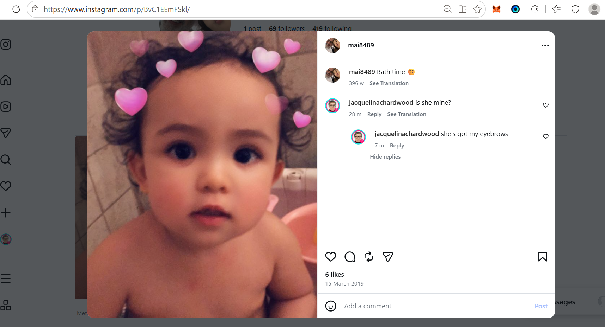
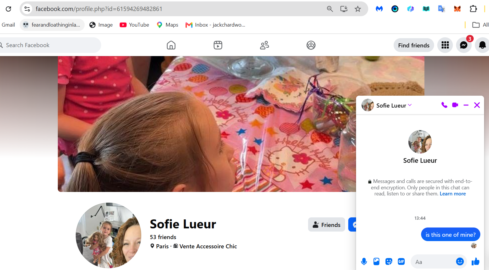
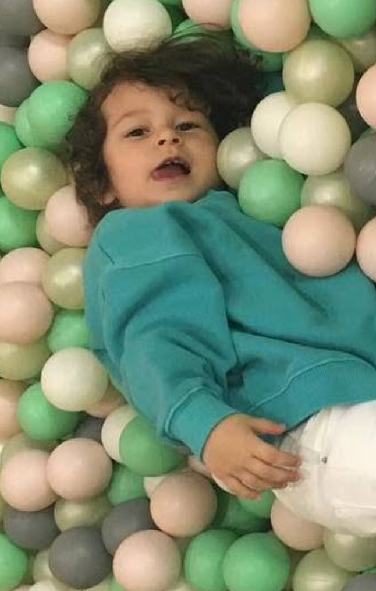
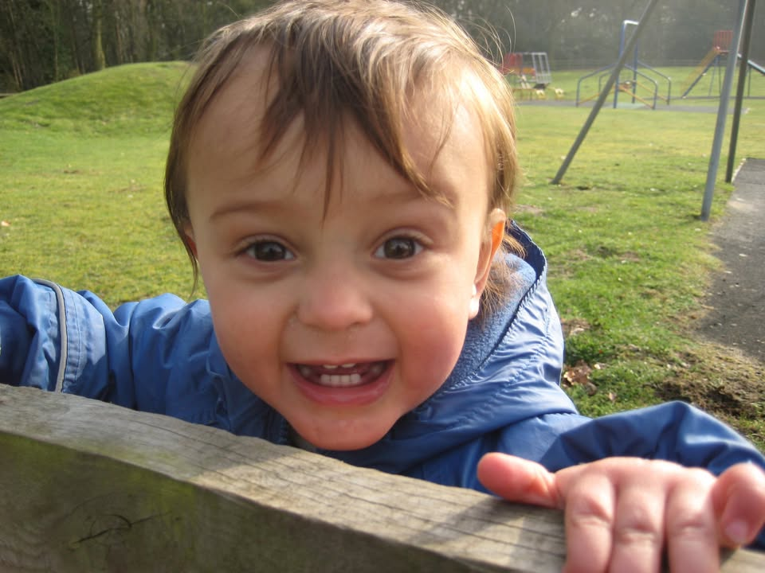

# Possible children

- I expect people are going to help me with this en masse because everyone loves their mothers and would do anything for them (unless they're unduly abusive).
- And let's do it before they all grow up and it's a million times worse for everyone.
- The thought of these poor kids growing up and finding out what happened to their true mothers and fathers - how they'd been stolen while their true parents were sedated, what the people pretending to be parents had done to them to explain away the effects of sedation or to keep them quiet about it if they found out - is just heart-breaking.

## Is she one of my children?

- She has my eyebrows.

## Is this another?

- She also has my eyebrows.
- Are there 32 children of mine in the world?

## Is this small boy one of mine?

- It's difficult to see. I'm more sure about number 2.

## Is Anita Diamond's boy one of mine?

- They were all over me like scabies when I moved to Denia, the Diamond-spies were in 2006; immediately setting me up with Dave Porter and then Adrian.
- And in between that a trip to a hotel in the middle of nowhere near an American military base - they had a discount.
- Then Anita at Qredo talking "alignment" with the gypsies in 2021 when I was at Lourdes and they were setting me up for the big spy-cam porn show.
- I guess we'll find out.

- If mine (and the others, like Steve's, not sure about Guruji if he has some special properties..) children have been a "research project" of sorts, they might be even paying them to have one while they "research", i.e. poke, prod.. etc.
- It's unconscionable.

